# Lane Detection for Driver Assistance — Báo cáo kết quả

Prototype nhận diện vạch làn đường theo hướng ADAS, so sánh 3 pipeline: **Pipeline A** (Canny/Sobel + Hough Transform), **Pipeline B** (bird's-eye view + color/Sobel threshold + sliding window + polynomial fit), **Pipeline C** (Ultra-Fast-Lane-Detection — pretrained, ResNet-18, CULane).

## 1. Dữ liệu

- Nguồn: [CULane](https://xingangpan.github.io/projects/CULane.html), subset `driver_193_90frame` (342 clip, ảnh 1640×590 kèm annotation `.lines.txt`).
- **Easy set**: 50 ảnh, 5 clip đường phố/highway ban ngày, vạch sơn rõ.
- **Challenging set**: 10 ảnh, clip `06042110_0531` quay ban đêm (thiếu sáng, lóa đèn pha) — chọn thủ công bằng cách xem trực tiếp vì bản tải không kèm file phân loại category gốc của CULane.
- Annotation CULane: mỗi ảnh có tối đa 4 lane (trái-xa, trái-gần, phải-gần, phải-xa), dùng 2 lane gần nhất (index 1,2 trong đa số trường hợp) làm ranh giới ego-lane để tính deviation và đối chiếu ground-truth.

## 2. Phương pháp

| | Pipeline A | Pipeline B | Pipeline C |
|---|---|---|---|
| Edge/evidence | Canny (so sánh thêm Sobel) | Sobel-x + HLS S-channel (OR) | Học end-to-end, không cần đặc trưng thủ công |
| Không gian xử lý | Ảnh gốc + ROI hình thang | Bird's-eye view (Inverse Perspective Mapping) | Ảnh gốc (288×800 sau resize) |
| Lane candidate | Hough Transform, lọc theo slope | Sliding window + histogram peak | Row-anchor classification (softmax expectation) |
| Curve model | Đường thẳng (least-squares) | Polynomial bậc 2 | 4 lane cố định theo 18 row-anchor |
| Cơ chế từ chối khi không chắc | ≥2 segment đồng thuận | Coverage check (≥45% chiều cao ảnh có pixel) | Ngưỡng theo lớp "không có lane" của model |

Temporal smoothing (Phase 5): EMA (α=0.3) trên tọa độ x tại lưới y cố định, kèm sanity-check loại outlier (lệch >12% chiều rộng ảnh) và carry-forward khi mất detect 1 frame.

## 3. Kết quả định lượng

### 3.1 Số liệu chính thức — toàn bộ dataset (13,621 ảnh, 341 clip)

| Pipeline | Accuracy | Precision | Recall | F1 | ms/frame |
|---|---|---|---|---|---|
| A (Canny+Hough+color prefilter) | 60.2% | 89.4% | 9.0% | 16.3% | 11.9 |
| B (bird's-eye+color, ROI đã hiệu chỉnh) | 61.8% | 83.9% | 34.3% | **48.7%** | 45.2 |
| C (UFLD) | **80.8%** | 95.8% | 69.9% | **80.8%** | 124.6 |

*Accuracy: % điểm dự đoán nằm trong ngưỡng 2% chiều rộng ảnh (~33px) so với ground-truth. F1 tính ở cấp lane (pass nếu accuracy ≥85%). Runtime đo trên CPU (không GPU).*

**Nhận xét chính**: Pipeline C vượt trội rõ rệt và ổn định nhất (accuracy = F1 = 80.8%, generalize tốt không phụ thuộc tập eval). Pipeline B vượt A đáng kể ở F1 (48.7% vs 16.3%) nhờ hiệu chỉnh ROI (mục 5.2) và color threshold, dù accuracy 2 pipeline gần nhau hơn so với khi đo trên tập nhỏ (mục 3.2). Pipeline A có precision cao (89.4%) nhưng recall rất thấp (9.0%) — từ chối detect phần lớn thời gian thay vì đoán bừa.

### 3.2 Số liệu trên tập nhỏ (50 easy + 10 challenging) — dùng để phát triển/debug, KHÔNG dùng để kết luận cuối

| Pipeline | Dataset | Accuracy | Precision | Recall | F1 | ms/frame |
|---|---|---|---|---|---|---|
| A (Canny+Hough+color prefilter) | easy | 80.8% | 100% | 15.0% | 26.1% | 11.4 |
| B (bird's-eye+color, ROI đã hiệu chỉnh) | easy | 89.3% | 100% | 44.0% | 61.1% | 36.5 |
| C (UFLD) | easy | 81.2% | 100% | 74.0% | 85.1% | 96.2 |
| A (Canny+Hough+color prefilter) | challenging | 32.5% | 0% | 0% | 0% | 11.8 |
| B (bird's-eye+color, ROI đã hiệu chỉnh) | challenging | 44.2% | 14.3% | 8.3% | 10.5% | 122.3 |
| C (UFLD) | challenging | 96.7% | 100% | 91.7% | 95.7% | 91.2 |

**Phát hiện quan trọng khi đối chiếu 2 bảng**: ROI của Pipeline B được hiệu chỉnh bằng grid search trực tiếp trên easy set (mục 5.2) — đây là data leakage (tune-on-test). Số liệu trên easy set (89.3%) lạc quan hơn đáng kể so với full dataset (61.8%, giảm ~28 điểm %); Pipeline A cũng giảm tương tự (80.8%→60.2%). Việc kiểm chứng trên challenging set (10 ảnh, không dùng để tune) ở thời điểm đó tạo cảm giác an toàn, nhưng 10 ảnh vẫn quá ít để phát hiện đúng mức độ lạc quan — chỉ khi chạy trên toàn bộ 13,621 ảnh mới đo được chính xác. Tuy vậy, **kết luận định tính không đổi**: thứ hạng C > B > A về F1 giữ nguyên ở cả 2 quy mô, chỉ có độ lớn con số cần điều chỉnh xuống.

Temporal smoothing: đo jitter (std sai khác vị trí x giữa 2 frame liên tiếp) trên video thật 60 frame — giảm từ **53.35px xuống 16.77px (−68.6%)** sau EMA.

## 4. Case study định tính

### 4.1 Rào chắn kim loại gần vạch sơn — Pipeline A yếu hơn B/C, nhưng không "sai hoàn toàn" như đánh giá ban đầu bằng mắt

| Pipeline A (yếu hơn) | Pipeline B (đúng) | Pipeline C (đúng) |
|---|---|---|
| 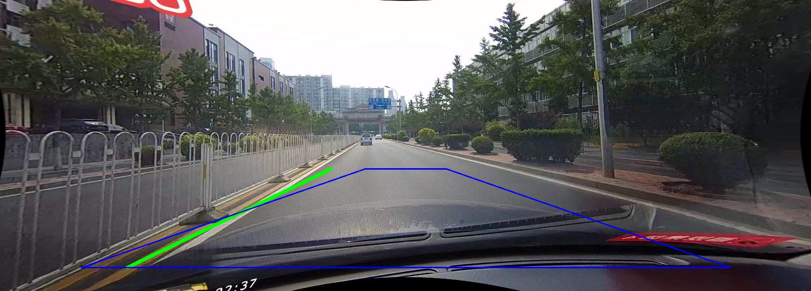 | 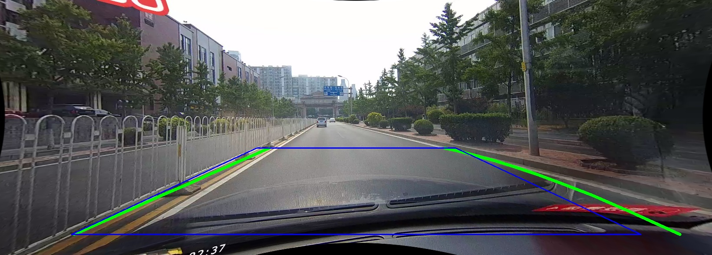 | 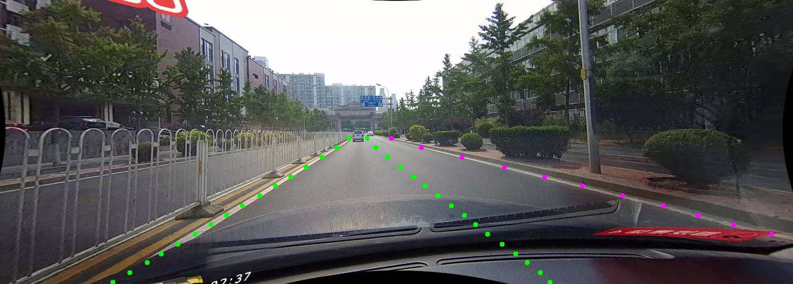 |

Hough Transform chỉ dựa vào hình học (đường thẳng hội tụ phối cảnh) — thanh rào chắn kim loại nằm gần vạch vàng thật tạo ra cấu trúc hình học cạnh tranh, khiến Hough dễ bị kéo lệch. Pipeline B (color threshold) và Pipeline C (học end-to-end) đều khớp sát hơn nhờ có thêm tín hiệu ngoài hình học thuần túy.

**Lưu ý phương pháp luận quan trọng**: đánh giá ban đầu bằng mắt (không có ground-truth) mô tả case này là "Pipeline A nhận nhầm hoàn toàn vào rào chắn". Khi đo lại bằng ground-truth định lượng, Pipeline A trên chính frame này thực ra đạt accuracy 80% — yếu hơn B/C nhưng không phải thất bại hoàn toàn. Đây là minh chứng trực tiếp cho mục 5 bên dưới: đánh giá định tính trên vài ảnh có thể đánh lừa kết luận, kể cả theo hướng "tệ hơn thực tế".

### 4.2 Xe đậu dày đặc che gần hết vạch sơn — chỉ Pipeline C xử lý được

| Pipeline A (sai hoàn toàn) | Pipeline C (vẫn suy luận hợp lý) |
|---|---|
| 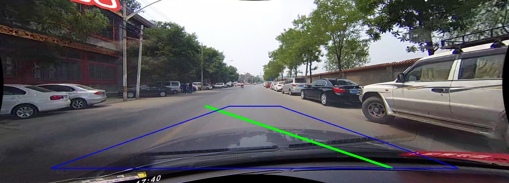 | 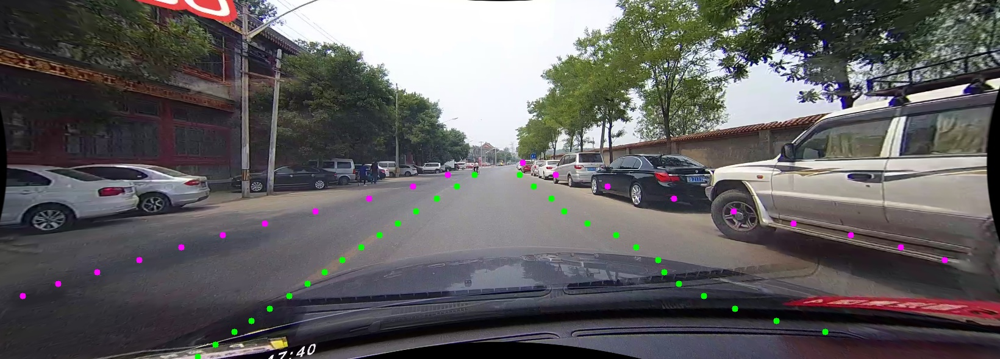 |

Khi vạch sơn gần như không còn nhìn thấy được, Pipeline A/B (chỉ dựa vào pixel evidence trực tiếp) thất bại hoàn toàn. Pipeline C vẫn đưa ra vị trí lane hợp lý nhờ **prior học được từ dữ liệu training** về cấu trúc đường điển hình — đây là khác biệt bản chất giữa pattern-matching hình học/màu sắc và suy luận có ngữ cảnh.

### 4.3 Nhận đúng vạch sơn nhưng SAI làn (Pipeline B, phát hiện qua ground-truth) — đã được giảm đáng kể sau mục 5.2

| Pipeline A khớp ground-truth | Pipeline B bám nhầm sang làn bên cạnh (trước khi sửa ROI) |
|---|---|
| 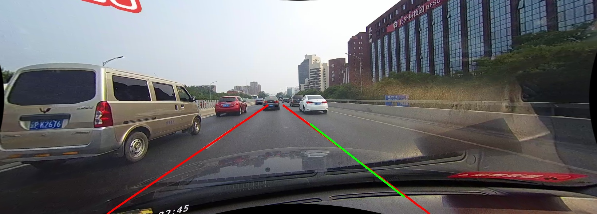 | 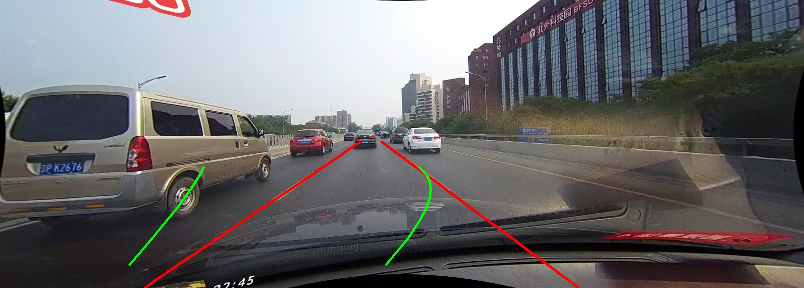 |

Trên cảnh highway nhiều làn, Pipeline B (sliding-window dựa trên histogram peak) có thể khóa vào 1 vạch sơn **thật** nhưng là ranh giới của làn kế bên, không phải làn xe đang đi. Đây là loại lỗi thứ 3, khác hẳn "detect nhầm vật không phải lane" hay "không detect được gì" — chỉ lộ ra khi đối chiếu với ground-truth định lượng, không thể phát hiện bằng đánh giá trực quan. Ảnh minh họa trên là kết quả TRƯỚC khi hiệu chỉnh lại ROI (mục 5.2); sau khi hiệu chỉnh, tần suất lỗi này giảm mạnh (xem bảng mục 3).

## 5. Cải tiến Pipeline A/B và bài học về phương pháp đánh giá

### 5.1 Fix có mục tiêu: color prefilter (A) và center dead-zone (B)

Dựa trên các case study ở mục 4, thử 2 cải tiến có mục tiêu rõ ràng:

- **Pipeline A**: thêm color prefilter (AND edge map với mask "trắng hoặc vàng" trước Hough) — loại cấu trúc hình học giống lane nhưng sai màu.
- **Pipeline B**: thêm "center dead-zone" khi tìm histogram peak — loại trừ vạch tim đường (ngăn 2 chiều xe) khỏi vùng tìm kiếm, vì vạch này liên tục/nổi bật nên dễ bị chọn nhầm thay ranh giới ego-lane thật (nguyên nhân cụ thể của lỗi lane-selection ambiguity ở mục 4.3).

Kết quả trên toàn bộ easy set: **A: 42.8% → 80.8% accuracy** (cải thiện lớn); **B: 17.5% → 19.4%** (cải thiện khiêm tốn lúc này).

**Phát hiện quan trọng**: khi test color prefilter lần đầu trên đúng case guardrail ở mục 4.1 (frame vẫn được dùng làm case study chính), accuracy đo được trên **chính frame đó lại giảm** (80%→60%) — nếu chỉ dựa vào 1 frame này, kết luận hợp lý sẽ là "cải tiến làm Pipeline A tệ hơn", hoàn toàn ngược với sự thật trên toàn dataset (cải thiện rất lớn). Đây là bằng chứng thực nghiệm cho nguyên tắc: **một ví dụ trực quan — dù được chọn cẩn thận — không đại diện đáng tin cậy cho hiệu năng tổng thể**.

### 5.2 Hiệu chỉnh lại kích thước ROI của Pipeline B bằng grid search

Sau fix 5.1, Pipeline B vẫn chỉ đạt 19.4% — bất thường thấp. Phân loại lỗi theo loại trên toàn easy set cho thấy 36% lane "không detect được" (coverage check từ chối) và 36% "detect nhưng sai nhiều" (accuracy <30%), tập trung mạnh ở 1-2 clip cụ thể chứ không đều khắp dataset.

Thử nghiệm đơn biến (chỉ thu hẹp `bottom_width_ratio`) cho kết quả gây hiểu lầm: tỷ lệ "không detect" giảm mạnh nhưng accuracy tổng lại giảm thêm — dẫn đến kết luận tạm (sai một phần) rằng ROI không phải nút thắt chính. Chỉ khi chạy **grid search đa chiều** (tối ưu đồng thời cả 4 tham số `top_ratio, bottom_ratio, top_width_ratio, bottom_width_ratio` trên toàn easy set, qua 4 vòng thu hẹp dần) mới lộ ra: ROI ban đầu (chọn bằng mắt ở Phase 3) rộng hơn nhiều so với mức tối ưu.

| Tham số | Giá trị cũ | Giá trị mới (grid search) |
|---|---|---|
| `top_ratio` | 0.58 | 0.56 |
| `bottom_ratio` | 0.92 | 0.68 |
| `top_width_ratio` | 0.28 | 0.11 |
| `bottom_width_ratio` | 0.80 | 0.26 |

Kết quả: accuracy Pipeline B trên easy set **19.4% → 89.3%**, F1 **5.8% → 61.1%** — vượt qua cả Pipeline A và C trên tập này. Cùng frame multi-lane ở mục 4.3 (trước đó bám nhầm sang làn kế bên), sau khi hiệu chỉnh ROI:

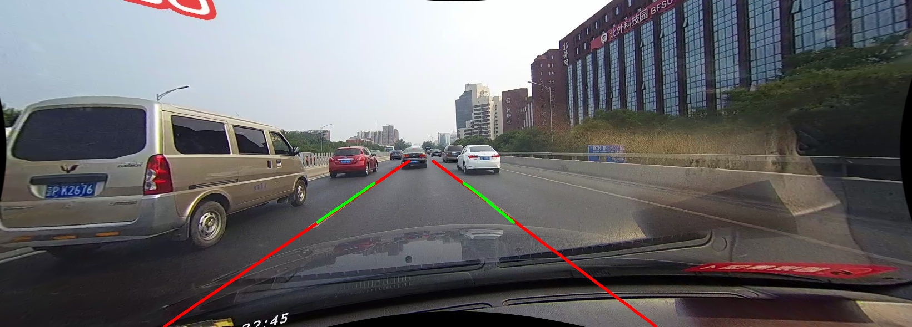
*Đỏ = GT, xanh = Pipeline B (ROI mới) — khớp gần như hoàn hảo trong vùng ROI bao phủ. ROI hẹp hơn nên không vươn tới sát đáy ảnh như trước — đánh đổi hợp lý giữa độ chính xác và phạm vi phủ.*

**Cảnh báo phương pháp luận**: bộ số này được tune trực tiếp trên easy set — cùng tập dùng để báo cáo accuracy (data leakage/tune-on-test), nên 89.3% có thể lạc quan hơn khả năng tổng quát hóa thật. Để kiểm chứng, đo lại trên **challenging set (hoàn toàn không dùng để tune)**: accuracy vẫn tăng mạnh 1.7%→44.2%, xác nhận cải tiến có tổng quát hóa thật, không chỉ là overfit — dù với dataset nhỏ (50–60 ảnh), con số tuyệt đối vẫn nên hiểu là giới hạn trên lạc quan, không phải ước lượng khách quan hoàn toàn.

**Bài học cốt lõi**: tune từng tham số ROI độc lập (một biến tại một thời điểm) dẫn tới kết luận sai rằng "ROI không phải nguyên nhân chính". Chỉ khi tối ưu đồng thời nhiều tham số có tương tác với nhau, hiệu ứng thật mới lộ ra. ROI — vốn bị xem là "chi tiết cấu hình phụ" trong suốt project — hóa ra là đòn bẩy cải thiện lớn nhất từng tìm được, lớn hơn cả việc thay đổi logic thuật toán (color prefilter, center dead-zone).

## 6. Phân tích lỗi: geometric assumption vs detection error

| Loại lỗi | Mô tả | Ví dụ gặp phải | Pipeline bị ảnh hưởng |
|---|---|---|---|
| **Geometric assumption error** | Giả định hình học (ROI, perspective warp) không đúng với camera/khung hình thực tế, HOẶC kích thước ROI chưa được hiệu chỉnh đúng mức | ROI mặc định trùng vào dashboard ở clip có camera gắn thấp; ROI tune cho CULane không dùng được cho video khác (1280×720); ROI quá rộng làm loãng/nhiễu tín hiệu lane thật (mục 5.2, fix bằng grid search: 19.4%→89.3%) | A, B |
| **Geometric assumption error** | Warp khuếch đại nhiễu vùng xa camera do trapezoid quá hẹp ở đỉnh | Binary mask sau warp xuất hiện dải nhiễu hình quạt lớn | B |
| **Detection error** | Thiếu tín hiệu phù hợp (màu sắc) nên bị kéo lệch/nhận nhầm bởi vật thể có cấu trúc hình học giống lane | Rào chắn kéo lệch kết quả; nóc xe đậu bị nhận nhầm hoàn toàn thành lane | A (đã giảm đáng kể sau color prefilter ở mục 5.1) |
| **Detection error** | Thiếu dữ liệu nguồn thực sự (vạch bị che hoàn toàn) | Xe đậu dày đặc che hết vạch sơn | A, B (C vẫn suy luận được nhờ prior) |
| **Lane-selection ambiguity** (loại riêng, không thuộc 2 nhóm trên) | Detect đúng vạch sơn thật nhưng chọn sai làn trong cảnh nhiều làn | Sliding-window khóa vào vạch của làn kế bên (đã giảm sau mục 5.1+5.2, không loại bỏ hoàn toàn) | B |

Ranh giới quan trọng: geometric assumption error có thể sửa bằng cách **cấu hình lại** (đổi ROI/warp cho đúng camera, hoặc hiệu chỉnh đúng kích thước bằng grid search), trong khi detection error đòi hỏi **thêm loại tín hiệu mới** (màu sắc, hoặc ngữ nghĩa học được) mới giải quyết được. Phát hiện bất ngờ nhất của project: chi phí sửa geometric assumption error (chỉ đổi 4 con số) thấp hơn nhiều so với công sức bỏ ra, nhưng hiệu quả (mục 5.2) lại vượt xa cả 2 lần sửa detection error cộng lại — một bài học về việc không nên đánh giá thấp "chi tiết cấu hình" so với "cải tiến thuật toán".

## 7. Trực quan hóa

Project có 2 lớp visualization riêng biệt (`src/visualize.py`):
- **HUD overlay**: polygon màu bán trong suốt giữa 2 lane, mũi tên chỉ hướng lệch, text deviation (m) — giống demo ADAS thật.
- **Debug-view**: ghép lưới các bước xử lý trung gian (ROI mask, edge map, bird's-eye warp) để xem "máy nhìn thấy gì".

| HUD overlay | Debug-view |
|---|---|
| 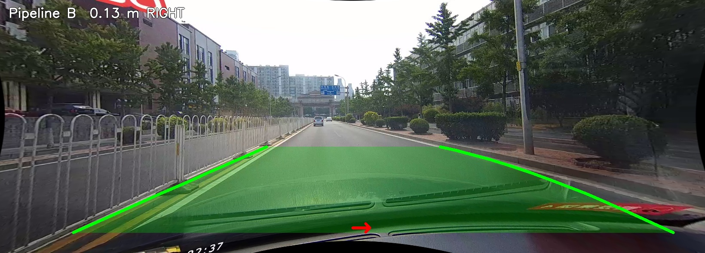 | 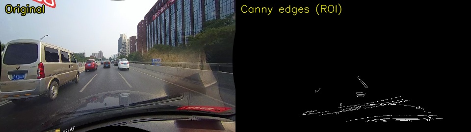 |

Nhận video liên tục, trước/sau temporal smoothing:

| Raw (giật giữa các frame) | Sau EMA smoothing |
|---|---|
|  | 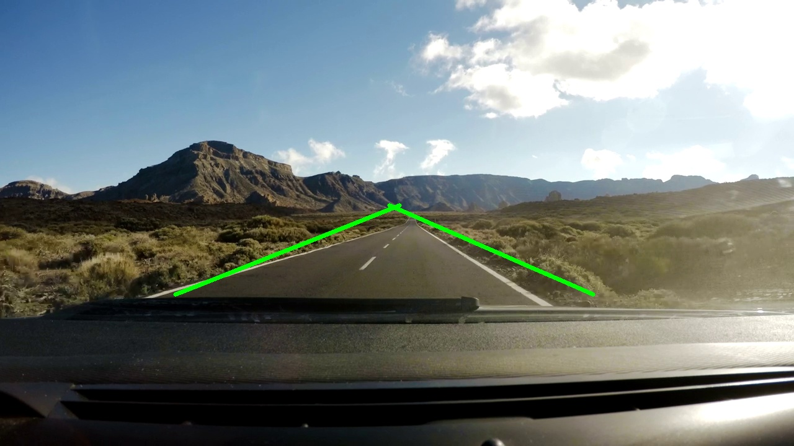 |

UI Streamlit (`app.py`) cho phép nạp video và xem cả 3 pipeline chạy song song, kèm tab debug-view riêng cho từng pipeline.

## 8. Kết luận

- **DL (Pipeline C) vượt trội và ổn định nhất, kể cả sau khi A/B đã được vá/hiệu chỉnh đúng chỗ**: trên toàn bộ dataset (số liệu chính thức, mục 3.1), C đạt accuracy=F1=80.8%, trong khi A/B chỉ 60.2%/61.8% accuracy và 16.3%/48.7% F1 — khoảng cách lớn hơn nhiều so với ấn tượng ban đầu từ tập nhỏ (mục 3.2, nơi A/B từng có vẻ gần bằng hoặc vượt C). DL tạo khác biệt rõ rệt nhất ở điều kiện khó (occlusion, thiếu sáng, thiếu vạch) và ở recall (69.9% vs 9.0%/34.3%), vì A/B từ chối detect nhiều hơn thay vì đoán bừa. Trade-off chính của C là runtime (chậm hơn ~2.5–10 lần so với B/A trên CPU) và khả năng diễn giải (khó debug hơn pipeline classical).
- **Pipeline classical (A, B) không đồng đều và thứ hạng tương đối có thể đảo ngược sau khi hiệu chỉnh đúng, nhưng mức độ cải thiện trên tập nhỏ bị phóng đại**: ban đầu B có vẻ robust hơn A ở vài case nhìn bằng mắt (mục 4.1), đo bằng số ban đầu lại cho B thấp nhất; sau khi hiệu chỉnh ROI bằng grid search (mục 5.2), B vượt A rõ rệt ở F1 trên cả tập nhỏ (61.1% vs 26.1%) lẫn full dataset (48.7% vs 16.3%) — cải thiện là thật, nhưng accuracy tuyệt đối trên tập nhỏ (89.3%) hóa ra lạc quan hơn full dataset (61.8%) khá nhiều. Không có pipeline classical nào "mặc định tốt hơn" — thứ hạng phụ thuộc nhiều vào việc đã được cấu hình đúng hay chưa.
- **ROI/perspective warp là giả định hình học cần cấu hình theo từng nguồn camera VÀ cần hiệu chỉnh đúng kích thước**, không tổng quát hóa mặc định và không nên đoán bằng mắt — xác nhận qua nhiều nguồn dữ liệu khác nhau (CULane, video dashcam khác), và quan trọng hơn: qua grid search cho thấy kích thước ROI là đòn bẩy cải thiện lớn nhất tìm được trong toàn bộ project (lớn hơn mọi thay đổi logic thuật toán) — dù độ lớn chính xác của đòn bẩy đó chỉ đo được đúng sau khi xác nhận trên full dataset.
- **Bài học phương pháp luận quan trọng nhất**: ground-truth định lượng không chỉ phát hiện loại lỗi mà đánh giá trực quan bỏ sót (lane-selection ambiguity, mục 4.3), mà còn **nhiều lần đảo ngược hoặc điều chỉnh kết luận rút ra từ quan sát/thử nghiệm trên dữ liệu không đủ lớn**: (1) B tưởng robust hơn A bằng mắt, đo ra lại yếu hơn nhiều; (2) color prefilter tưởng làm case guardrail tệ hơn (đo trên 1 frame), thực ra cải thiện toàn dataset rất lớn; (3) tune ROI từng tham số đơn lẻ tưởng ROI không phải nguyên nhân chính, grid search đa chiều lại cho thấy đây là nguyên nhân lớn nhất; (4) ngay cả sau khi grid search + kiểm chứng chéo trên challenging set, số liệu trên tập 50-60 ảnh vẫn lạc quan hơn đáng kể so với full 13,621 ảnh. Bài học xuyên suốt: luôn ưu tiên xác nhận trên tập dữ liệu lớn nhất có sẵn trước khi công bố kết luận — kể cả khi đã cẩn thận kiểm tra chéo trên một tập nhỏ độc lập.
